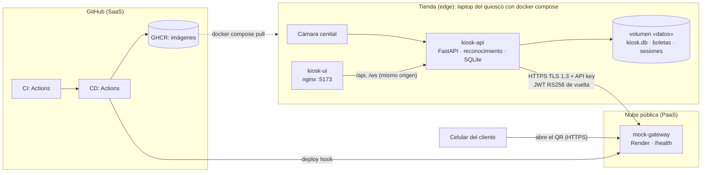
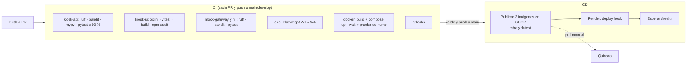

# Cloud y DevOps en AutoCaja

Criterio 1 de la rúbrica APF 3: aplicar Cloud Computing y DevOps en la arquitectura del proyecto y justificar la integración y el despliegue continuos (CI/CD).

> **Qué se probó y qué no** (2026-11-19). Se probaron en local: las tres imágenes Docker, el `docker-compose.yml` levantado desde cero y la prueba de humo `ops/smoke_compose.py`, que recorre una compra completa. También la pasarela en «modo nube» (sin TLS propio, puerto dado por el proveedor) y la verificación TLS 1.3 contra un certificado público desde la imagen. Los workflows pasan `actionlint`. **No se ha ejecutado** el workflow de CD (corre al fusionar en `main`) ni el despliegue en Render (falta crear la cuenta y el servicio). Tampoco se ha probado el modo cámara en contenedor con una webcam: la imagen compila, pero no se probó con la cámara. Las cifras sin fuente marcada son estimaciones y lo dicen.

## 1. Resumen de la decisión

| Pregunta | Decisión | Por qué, en una línea |
|---|---|---|
| ¿Dónde corre el reconocimiento? | **En el quiosco (edge)** | RNF-01 exige ≤ 150 ms. Las fotos no deben salir de la tienda (Ley 29733) y el quiosco debe operar sin internet (RNF-03) |
| ¿Qué va a la nube? | **La pasarela de pago** | Es un servicio compartido, por naturaleza remoto, que se actualiza sin tocar los quioscos |
| ¿Cómo se empaqueta? | **Contenedores Docker**, uno por servicio, y `docker compose` | La misma imagen corre en la laptop del desarrollador, en el CI, en el quiosco y en la nube |
| ¿Qué modelo de nube? | **PaaS** (Render, plan gratuito) para la pasarela | No hay servidores que administrar y HTTPS viene incluido. Para un MVP universitario es lo que menos operación exige |
| ¿Cómo llega el código a producción? | **CI en cada PR → CD solo si el CI pasa en `main`** | Ningún cambio llega al quiosco ni a la nube sin pasar pruebas, análisis de seguridad y una compra completa en contenedores |

## 2. Conceptos de Cloud Computing aplicados

### 2.1 Qué es y qué características usamos

El NIST (SP 800-145) define la computación en la nube por cinco características. Así aparecen en el proyecto:

| Característica (NIST) | En AutoCaja |
|---|---|
| Autoservicio bajo demanda | La pasarela se crea desde un archivo (`render.yaml`, *Blueprint*) sin pedir nada a un operador |
| Acceso amplio por red | El quiosco y el «celular» del cliente llegan a la pasarela por HTTPS desde cualquier red |
| Recursos compartidos (*pooling*) | El plan gratuito de Render corre en infraestructura compartida entre clientes |
| Elasticidad | Render puede escalar la pasarela a más instancias (en planes de pago). El quiosco, en cambio, es un equipo fijo |
| Servicio medido | Render mide horas de instancia y ancho de banda. GitHub mide los minutos de Actions y el espacio de GHCR |

### 2.2 Modelos de servicio: dónde cae cada pieza

| Modelo | Qué administra el proveedor | Pieza de AutoCaja |
|---|---|---|
| **IaaS** (infraestructura) | Hardware, red, virtualización | No se usa hoy. Alternativa: una VM en AWS EC2 o Azure con Docker. Da más control, pero hay que parchar el sistema operativo |
| **PaaS** (plataforma) | Además: sistema operativo, runtime, balanceo y TLS | **`mock-gateway` en Render**: entregamos un Dockerfile y Render lo construye, lo corre, le da HTTPS y vigila `/health` |
| **CaaS** (contenedores) | Orquestación de contenedores | **GitHub Container Registry (GHCR)** guarda las imágenes versionadas que publica el CD |
| **SaaS** (software) | Toda la aplicación | **GitHub** (código, Actions, Dependabot) y **Mercado Pago** para cobrar con Yape por API (`docs/PAGO_YAPE.md`). En un piloto real, también la facturación electrónica (SUNAT/OSE) |

### 2.3 Modelo de despliegue: híbrido edge + nube pública

El quiosco es un equipo **edge**, local a la tienda. La pasarela vive en la **nube pública**. Juntos forman una arquitectura **híbrida**.



### 2.4 Edge frente a nube: por qué la inferencia no va a la nube

| Criterio | Inferencia en el quiosco (elegido) | Inferencia en la nube |
|---|---|---|
| Latencia (RNF-01 ≤ 150 ms) | Medido en desarrollo: YOLOv8n a 416 px, p95 de 126 ms. Galería: ~110–150 ms por cuadro (`docs/ml/benchmark.md`) | A eso se suma la ida y vuelta Lima–EE. UU. y la subida de cada cuadro. *Estimación, no medida:* decenas de ms por petición, más el tiempo de subir la imagen. Se comería el margen de 150 ms |
| Sin internet (RNF-03) | El catálogo está en SQLite local: reconoce aunque se caiga la red. Solo el pago necesita red | Sin red, el quiosco queda ciego |
| Privacidad (Ley 29733) | Las imágenes no salen de la tienda | Cada cuadro de la cámara viaja a un tercero, con más obligaciones legales |
| Coste | La CPU del quiosco ya está pagada | Pago por cómputo o GPU según el uso, en cada cuadro |
| Actualizar el modelo | Hay que llevar la imagen nueva a cada quiosco (`docker compose pull`) | Se cambia en un solo lugar |

**Conclusión:** en la nube va lo que es compartido y no es crítico en tiempo (pagos y, a futuro, catálogo central, métricas y alertas de varias tiendas). En el edge va lo que tiene que responder en milisegundos y funcionar sin red.

## 3. Contenedores

| Imagen | Base | Tamaño (medido) | Qué hace |
|---|---|---|---|
| `autocaja-kiosk-api` | `python:3.12-slim` | 260 MB | API del quiosco, modo simulado. Con `--build-arg EXTRAS=vision` (712 MB) añade OpenCV y ONNX Runtime para la cámara |
| `autocaja-mock-gateway` | `python:3.12-slim` | 257 MB | Pasarela. Local: TLS 1.3 propio en :8443. Nube: `GATEWAY_TLS=off`, HTTP en `$PORT` detrás del proxy HTTPS del proveedor |
| `autocaja-kiosk-ui` | `node:22-alpine` → `nginx-unprivileged` | 75,7 MB | Compila React con Node y sirve solo los archivos estáticos con nginx (*multi-stage*). Hace de proxy de `/api`, `/sim/` y `/ws` hacia `kiosk-api` |

**Decisiones y su motivo**
- **Configuración por variables de entorno** (factor III de *The Twelve-Factor App*). La misma imagen sirve en local, en el CI y en la nube; solo cambian `GATEWAY_TLS`, `GATEWAY_URL`, `GATEWAY_CA`, `KIOSK_DATA_DIR`, etc. Los valores por defecto siguen siendo los de desarrollo (`127.0.0.1`), así que nada cambió para quien corre el proyecto sin Docker.
- **Secretos fuera de la imagen.** Las claves se generan en un volumen (`claves`) con un contenedor de un solo uso. En Render, la clave privada JWT va como *Secret File*. `.dockerignore` excluye `keys/`, `*.pem` y `.env`.
- **Mínimo privilegio.** Los contenedores corren sin root (UID 10001 y nginx sin privilegios). Los puertos se publican solo en `127.0.0.1`. `kiosk-api` no publica ningún puerto: solo se llega a ella a través de nginx. Así el navegador ve un único origen, el mismo que exige la API (`http://localhost:5173`).
- **Estado en volúmenes.** `kiosk.db`, las boletas, las sesiones y el log van al volumen `datos` (`KIOSK_DATA_DIR`), así que sobreviven a una actualización de la imagen.
- **Sondas de salud.** Hay `HEALTHCHECK` en la API (`/api/state`) y en la UI, y `/health` en la pasarela. `docker compose` arranca cada servicio solo cuando su dependencia está sana: claves → pasarela → API → UI.
- **TLS entre contenedores.** El quiosco llama a la pasarela por el nombre del servicio (`https://mock-gateway:8443`), así que el certificado de desarrollo incluye ese nombre (`devkeys --san mock-gateway`). TLS 1.3 sigue siendo obligatorio (RNF-04).

## 4. DevOps: el ciclo aplicado al proyecto

DevOps une desarrollo y operación en un ciclo continuo, con automatización y retroalimentación rápida. Cada fase tiene aquí un artefacto concreto:

| Fase | Cómo se hace en AutoCaja | Dónde |
|---|---|---|
| Planificar | Requisitos medibles (SRS), rúbrica, tablero del equipo | `docs/SRS.md`, `docs/GUIA_EQUIPO.md` |
| Codificar | Una rama por criterio, PR hacia `develop`, revisión | Reglas en `CLAUDE.md` |
| Construir | Imágenes Docker reproducibles desde la raíz del repo | `*/Dockerfile`, `docker-compose.yml` |
| Probar | ruff, mypy, bandit, oxlint, pytest (cobertura ≥ 90 %), vitest, Playwright, prueba de humo en contenedores, mutación semanal | `.github/workflows/ci.yml`, `mutation.yml` |
| Publicar (*release*) | Imágenes en GHCR etiquetadas con el SHA del commit y `latest` | `.github/workflows/cd.yml` |
| Desplegar | Pasarela: deploy hook de Render y espera de `/health`. Quiosco: `docker compose pull` | `cd.yml`, `render.yaml` |
| Operar | `restart: unless-stopped`, volúmenes, log rotado (`kiosk.log`), recalibrar y reactivar desde `/caja` | `docker-compose.yml`, panel de caja |
| Monitorear | Sondas de salud. Métricas de negocio frente al SRS (`python -m kiosk.metrics`). Alertas de seguridad en `/caja` | `kiosk/metrics.py`, `/api/alerts` |

**Seguridad integrada (DevSecOps):** gitleaks busca secretos en todo el historial, bandit hace análisis estático de Python, `npm audit` revisa dependencias, y Dependabot actualiza pip, npm, Actions y, desde ahora, las imágenes base de Docker.

## 5. El pipeline CI/CD



**Por qué está armado así**

1. **Deploy solo de lo que pasó las pruebas.** El CD no se dispara con un `push`, sino con `workflow_run` cuando el CI de `main` termina **en verde**. Además, construye el **commit exacto** que se probó (`head_sha`), no el último de la rama.
2. **La prueba de humo en contenedores es la puerta de calidad del CD.** El job `docker` del CI construye las tres imágenes, las levanta con `docker compose up --wait` y recorre una compra real: interfaz → API → pasarela por TLS 1.3 con certificado verificado → ticket W4 → boleta. Si alguien rompe un Dockerfile, la configuración de nginx o el TLS entre servicios, el PR no pasa. Las pruebas unitarias no detectan esos fallos.
3. **Versiones inmutables y vuelta atrás.** Cada imagen lleva la etiqueta del SHA del commit. Para volver a una versión anterior en el quiosco basta con `AUTOCAJA_VERSION=<sha> docker compose up -d`.
4. **Entrega continua para el quiosco, despliegue continuo para la nube.** La pasarela se despliega sola, porque un servicio en la nube se reemplaza sin cortar a nadie y la sonda `/health` confirma que quedó bien. El quiosco recibe la imagen, pero se actualiza a mano: es un equipo físico atendiendo clientes y no conviene reiniciarlo en medio de una compra.
5. **Un despliegue a la vez** (`concurrency`), en el entorno `produccion` de GitHub. Ahí se pueden exigir aprobaciones y ver el historial de despliegues.
6. **Mínimos permisos.** El CI solo lee. El CD solo pide `packages: write` para GHCR. El deploy hook es un secreto del repositorio.

**Cómo se mediría el beneficio (métricas DORA).** Frecuencia de despliegue: ejecuciones del CD por semana. Tiempo de entrega: del merge a `/health` en verde, según los tiempos del workflow. Tasa de fallos de cambio: despliegues que requieren volver atrás. Tiempo de recuperación: cuánto se tarda en desplegar el SHA anterior. **Aún no hay datos**, porque el CD no se ha ejecutado. Se llenan después de las primeras semanas de uso.

## 6. Cómo usarlo

### 6.1 Todo en una máquina (demo local)

```bash
cp .env.example .env            # cambia GATEWAY_API_KEY por una clave larga
docker compose up --build       # http://localhost:5173  ·  /sim  ·  /caja
# Prueba de humo (otra terminal):
docker compose cp mock-gateway:/app/keys/ca.pem /tmp/ca.pem
python3 ops/smoke_compose.py --ca /tmp/ca.pem
docker compose down             # añade -v para borrar claves y datos
```

El «celular» abre `https://localhost:8443/pay/...`. El navegador avisará de que el certificado no es de confianza, porque es la CA de desarrollo. Las métricas del SRS se ven con `docker compose exec kiosk-api python -m kiosk.metrics /datos/sesiones.jsonl`.

### 6.2 Modo cámara en contenedor (Linux, sin probar con webcam)

```bash
docker compose -f docker-compose.yml -f docker-compose.camara.yml up --build
```

Necesita `ml/data/models/` con la galería y los modelos (ver `docs/ml/reconocimiento.md`) y la webcam en `/dev/video0`.

### 6.3 Pasarela en Render (lo hace el equipo, una vez)

1. Generar un par de claves solo para la nube, distinto del de desarrollo:
   `mkdir keys-nube && docker run --rm --user "$(id -u):$(id -g)" -v "$PWD/keys-nube:/out" autocaja-mock-gateway:local python -m gateway.devkeys --out /out` (o, sin Docker, `python -m gateway.devkeys --out keys-nube`). La carpeta `keys-nube/` está fuera de git.
2. En Render: **New → Blueprint**, elegir este repositorio (lee `render.yaml`). En el servicio `autocaja-pasarela`:
   - *Environment → Secret Files*: subir `keys-nube/gateway_jwt_private.pem` con ese mismo nombre.
   - *Environment*: poner `GATEWAY_API_KEY` (la misma del `.env` del quiosco).
   - *Settings → Deploy Hook*: copiar la URL.
3. En GitHub (*Settings → Secrets and variables → Actions*): el secreto `RENDER_DEPLOY_HOOK_URL` y la variable `PASARELA_URL` (p. ej. `https://autocaja-pasarela.onrender.com`).
4. En el quiosco: añadir `PASARELA_URL=...` al `.env`, dejar en `keys-nube/` solo `gateway_jwt_public.pem` (borrar ahí la privada) y levantar:
   `docker compose -f docker-compose.yml -f docker-compose.nube.yml up --build --no-deps kiosk-api kiosk-ui`

El quiosco verifica el certificado público de Render con las CA del sistema (`GATEWAY_CA=system`) y sigue exigiendo TLS 1.3. Se comprobó desde la imagen que `render.com` negocia TLS 1.3. La firma RS256 de cada pago se valida con la clave pública de `keys-nube/`.

### 6.4 Actualizar el quiosco con las imágenes del CD

```bash
AUTOCAJA_IMAGEN=ghcr.io/nakusuo/autocaja AUTOCAJA_VERSION=latest docker compose pull
AUTOCAJA_IMAGEN=ghcr.io/nakusuo/autocaja AUTOCAJA_VERSION=latest docker compose up -d --no-build
```

GHCR crea los paquetes como privados. Para bajarlos hay que hacer `docker login ghcr.io` con un token de lectura o marcarlos como públicos en GitHub.

## 7. Limitaciones y riesgos

- **Arranque en frío del plan gratuito.** Render apaga el servicio tras un rato sin tráfico y la primera petición tarda en despertarlo. Eso puede romper ON-01 (cobro en ≤ 45 s) en el primer pago. Mitigación para la demo: abrir `PASARELA_URL/health` unos minutos antes, o pasar a un plan de pago en un piloto.
- **Render construye desde el repositorio**, no reutiliza la imagen de GHCR. Por eso la imagen de la nube no es byte a byte la misma que se probó. El Dockerfile y el commit sí son los mismos. Se podría cambiar a un servicio basado en imagen (imagen de GHCR + credenciales de registro) a cambio de más configuración.
- **Los cobros pendientes viven en memoria.** Si Render reinicia la pasarela, se pierden los QR abiertos en ese momento. Para un piloto haría falta una base de datos administrada (PaaS).
- **El quiosco no se actualiza solo.** Es una decisión, no un olvido: ver la sección 5, punto 4. Con varios quioscos convendría una herramienta de flota (p. ej. Watchtower con ventana de mantenimiento, o un orquestador edge).
- **Docker en el quiosco** añade una capa. Para la cámara hay que pasar `/dev/video0` y el grupo `video`. Está escrito en `docker-compose.camara.yml`, pero no está probado.
- **Sin balanza no hay antifraude por peso.** Es independiente de la nube, pero se recuerda porque afecta lo que la arquitectura puede garantizar (ver `docs/ESTADO.md`).
