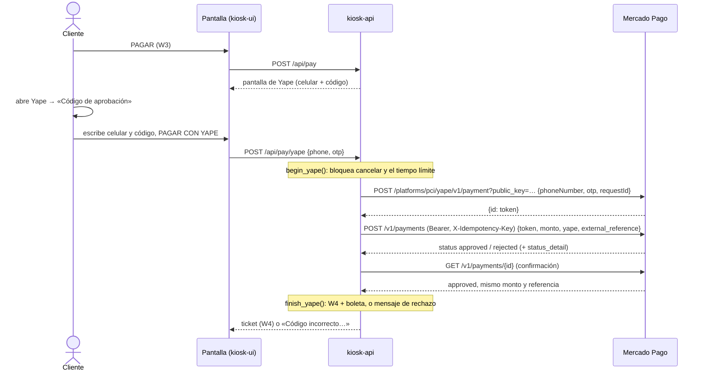

# Pago con Yape vía Mercado Pago

El quiosco puede cobrar con **Yape real** a través de la **Checkout API de Mercado Pago**. El cliente escribe en la pantalla su celular y el *código de aprobación* que le muestra su app Yape. El quiosco cobra y recibe la respuesta en la misma llamada: aprobado o rechazado.

> **Qué se probó y qué no** (2026-11-19). Se probó el flujo completo contra la **imitación de Mercado Pago** que trae `mock-gateway`: mismos endpoints, mismos campos y mismos números de prueba que publica Mercado Pago. Se probó en pruebas unitarias, en la prueba de humo con Docker y con capturas de la pantalla. **No se ha probado contra el sandbox real de Mercado Pago**, porque faltan las credenciales de prueba del equipo. El código está escrito según la documentación pública de Mercado Pago Perú (página «Yape» de Checkout API), pero algunos detalles solo se confirman con la API real: el código HTTP exacto de cada error y si acepta el correo genérico del pagador. Ver §6.

## 1. Por qué Mercado Pago

Yape y Plin **no tienen una API pública** para comercios. Se llega a ellos a través de una pasarela.

| Pasarela | Yape por API | Sandbox con números de prueba | Documentación del flujo | Elegida |
|---|---|---|---|---|
| **Mercado Pago** | Sí (token con celular + código, luego cobro) | Sí: 8 números con resultados distintos (§5) | Completa y pública, incluido el endpoint del token desde el servidor | **Sí** |
| Culqi | Sí | Un solo número de prueba (900 000 001) | La referencia de la API no se pudo leer (se renderiza solo en el navegador) | No, por ahora |
| Izipay / Niubiz | Sí | Requiere certificación o volumen de ventas alto | Pensada para comercios grandes | No |
| QR interoperable (p. ej. TAYPI) | Sí, Yape y Plin por QR | Según el proveedor | Blog del proveedor, sin documentación oficial del BCRP | Alternativa para Plin (§7) |

**Una ventaja para el quiosco:** con Yape por Checkout API la respuesta es **síncrona**. El quiosco no necesita una URL pública para recibir *webhooks*, así que puede seguir en la red local de la tienda (edge), detrás de un router, sin abrir puertos.

## 2. Flujo



Código: `MercadoPagoYape` en `kiosk-api/src/kiosk/payments.py`; `begin_yape` / `charge_yape` / `finish_yape` en `service.py`; endpoint `POST /api/pay/yape` en `app.py`; pantalla `kiosk-ui/src/kiosk/screens/PagoYape.tsx`.

## 3. Decisiones de seguridad

| Riesgo | Qué hace el quiosco |
|---|---|
| Datos interceptados | TLS 1.3 obligatorio también hacia Mercado Pago (RNF-04). Se verifica el certificado con las CA del sistema |
| Celular o código guardados | No se guardan ni se registran en el log. Solo viajan en la petición a Mercado Pago. La API valida el formato (9 y 6 dígitos) |
| Cobrar dos veces el mismo intento | Cada intento lleva su propia `X-Idempotency-Key` (`venta-N-<uuid>`) |
| Respuesta alterada o equivocada | Tras un «approved» se **vuelve a consultar** el pago (`GET /v1/payments/{id}`) y se exige estado aprobado, el mismo monto y la misma referencia de venta. Si no cuadra, no se entrega el ticket |
| Cliente cancela mientras se cobra | Mientras Mercado Pago responde no se puede cancelar y no corre el tiempo límite de 120 s |
| Pago aprobado que ya no corresponde a la compra en pantalla | No se da la compra por pagada. Se crea una **alerta en `/ayuda`** con la operación y el monto «para devolver», y nunca se descarta |
| Probar códigos al azar | Máximo **3 rechazos** por compra. Luego se pide ayuda en caja |
| Credenciales | `MP_ACCESS_TOKEN` y `MP_PUBLIC_KEY` solo por variables de entorno (`.env`, fuera de git) |

**Cambio respecto de la pasarela simulada:** con QR, la confirmación llegaba como un **JWT firmado RS256** (RNF-05). Con Mercado Pago, la autenticidad la dan el canal TLS hacia `api.mercadopago.com` con certificado verificado y el *access token* privado. Además se hace la consulta de confirmación. Mercado Pago no firma sus respuestas con una clave nuestra, así que RNF-05 se cumple de otra forma. Conviene decirlo así en la sustentación.

## 4. Cómo usarlo

| Modo | Cómo | Para qué |
|---|---|---|
| QR simulado (por defecto) | `docker compose up` | La demo de siempre, sin Yape |
| **Yape contra la imitación** | `KIOSK_PAYMENT=yape docker compose up` | Demo y CI sin credenciales. Mismos números de prueba que Mercado Pago |
| **Yape contra el sandbox real** | `docker compose -f docker-compose.yml -f docker-compose.mercadopago.yml up` | Probar con Mercado Pago de verdad (dinero de prueba) |
| Producción | Igual que el sandbox, con credenciales de producción | Requiere cuenta verificada en Mercado Pago. No lo hemos hecho |

Sin Docker: `KIOSK_PAYMENT=yape MP_PUBLIC_KEY=... MP_ACCESS_TOKEN=... python -m kiosk`. Por defecto `MP_BASE_URL` es `https://api.mercadopago.com`.

### Conseguir las credenciales de prueba (lo hace el equipo, una vez)

1. Entrar a [mercadopago.com.pe/developers](https://www.mercadopago.com.pe/developers) con una cuenta de Mercado Pago Perú.
2. *Tus integraciones* → **Crear aplicación** (tipo «Pagos online», producto Checkout API).
3. En la aplicación → **Credenciales de prueba**: copiar la *Public Key* y el *Access Token*.
4. Ponerlos en el `.env` del proyecto (nunca en git):
   ```
   MP_PUBLIC_KEY=TEST-...
   MP_ACCESS_TOKEN=TEST-...
   ```
5. Levantar con `docker-compose.mercadopago.yml` y pagar con los números de §5.

## 5. Números de prueba

Son los que publica Mercado Pago (código `123456` para todos). La imitación de `mock-gateway` responde igual. 

| Celular | Resultado | Mensaje en el quiosco |
|---|---|---|
| 111111111 | Aprobado | (ticket) |
| 111111112 | `cc_rejected_call_for_authorize` | «Yape pidió autorizar el pago…» |
| 111111113 | `cc_amount_rate_limit_exceeded` | «Superaste el límite de tu Yape…» |
| 111111114 | `cc_unsupported_unsupported` | Mensaje genérico |
| 111111115 | `cc_rejected_card_type_not_allowed` | Mensaje genérico |
| 111111116 | `cc_rejected_max_attempts` | «Demasiados intentos en Yape…» |
| 111111117 | `cc_rejected_bad_filled_security_code` | «Código de aprobación incorrecto o vencido…» |
| 111111118 | `cc_rejected_form_error` | «Revisa el número de celular y el código» |

En la imitación, cualquier otro celular se aprueba (para escribir uno real en la demo), y un código distinto de `123456` en un número de prueba da «código incorrecto». En la imitación **no se mueve dinero**.

## 6. Limitaciones y lo que falta confirmar

- **Sin probar contra Mercado Pago real** (ver la nota al inicio). Falta confirmar en el sandbox: el código HTTP con que se rechaza un código Yape inválido (el quiosco trata cualquier 4xx del token como «celular o código incorrecto»), si el correo genérico del pagador (`MP_PAYER_EMAIL`, por defecto `cliente@autocaja.pe`) es aceptado, y si el formato de `transaction_amount` coincide (se envía en soles con decimales, p. ej. `4.3`).
- **Límites de Yape:** según Mercado Pago, cada usuario tiene un tope configurado en su app (S/ 500, S/ 900 o S/ 2000). La imitación rechaza montos mayores a S/ 2000. El quiosco cobra como máximo 3 productos, así que no debería llegar a esos montos.
- **Comisiones y requisitos de producción** (RUC, verificación de la cuenta): no los verificamos. Dependen del contrato con Mercado Pago.
- **Devoluciones:** si aparece la alerta «Pago Yape aprobado sin compra en curso», hoy la devolución se hace a mano desde el panel de Mercado Pago. Se podría automatizar con su API de reembolsos.
- **Plin no entra por este camino.** Mercado Pago cobra Yape, no Plin (ver §7).

## 7. Siguiente paso posible: Plin con QR interoperable

Plin no tiene API propia: se cobra con el **QR interoperable** del BCRP, que también pagan Yape y las apps de los bancos. Para aceptar Plin habría que sumar una pasarela de QR interoperable con aviso por *webhook*. Ese flujo se parece al QR simulado que ya existe (`create_charge` + consulta del estado), así que encajaría detrás de la misma interfaz `PaymentGateway`. Necesitaría una URL pública para el webhook, o consultar el estado periódicamente.
